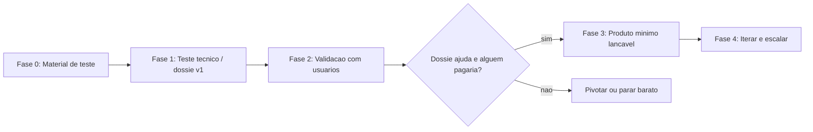

# Plano Mestre — Dossiê de Conversas de WhatsApp

> Documento de referência do projeto. Mantenha-o atualizado quando decisões mudarem.
> O andamento do dia a dia fica em [DIARIO.md](DIARIO.md).

## O que é o projeto

Uma ferramenta que transforma a exportação de uma conversa de WhatsApp (texto + áudios + imagens + PDFs + vídeos) em um **dossiê compreensível**, para dois consumidores:

- **Uma IA** (ChatGPT, Claude): Markdown com transcrições fiéis, descrições de mídia com contexto e citações por mensagem, para analisar a conversa sem perder o sentido das mídias.
- **Um humano** (futuramente): versão legível/PDF.

### Princípios já decididos

1. **Dado bruto intocado**: transcrições nunca são "corrigidas" por LLM; contexto entra como camada separada de anotação.
2. **Processamento iterativo e cronológico**: cada mídia é interpretada com o contexto acumulado (incluindo transcrições anteriores) e algumas mensagens posteriores.
3. **Conteúdo pesado vira ficha com link** (`anexos/doc-NNN.md`): um livro em PDF nunca entra inteiro no dossiê.
4. **Núcleo separado do canal**: o motor (ler → transcrever → descrever → gerar dossiê) não depende de como o cliente consome (CLI, web, WhatsApp).

### Hipótese de negócio (a validar, não decidida)

Mercado mais promissor: **profissionais que fecham negócios/casos pelo WhatsApp** (advogados, arquitetos, corretores). A dor: organizar e entender milhares de mensagens e centenas de áudios — brasileiro manda muito áudio, e nenhuma ferramenta conhecida trata isso bem.

Posicionamento possível: **complemento de autenticação, não concorrente** — Verifact/ata notarial fazem a prova; nós fazemos a organização e análise.

Referência de mercado: chatview.ai (US$ 5–20 por chat, pagamento avulso sem assinatura, foco EUA/jurídico com Bates numbering, privacidade "no browser" como argumento central, não trata áudios).

### Restrições conhecidas

- **Exportação corta histórico**: ajuda antiga do WhatsApp falava em ~10k mensagens com mídia / 40k sem; mídias só as recentes. WhatsApp Web/Windows permite intervalo de datas mas sem mídia.
- **Bot no WhatsApp**: proibido pela Meta para IA como função principal desde 15/jan/2026 (Brasil +55 excetuado por ordem do CADE; Europa liberada por 12 meses mediante taxa por mensagem). Situação instável — não construir dependendo disso.
- **LGPD/consentimento**: conversas de terceiros irão para a API da OpenAI; precisa ser opção explícita e informada.
- **Prova judicial**: hash não autentica conversa; STJ exige cadeia de custódia/perícia quando há dúvida razoável. **Não prometer validade jurídica.**

### Histórico

- O projeto começou como fork do [whatsapp-chat-viewer](https://github.com/rodrigodesalvobraz/whatsapp-chat-viewer) (MIT), mas o clone foi abandonado em 31/10/2026: parser só lia formato Android, saída era HTML, processamento de mídia em silos sem contexto acumulado. Ideias aproveitadas: id estável por mensagem (hash) e estrutura de prompts com contexto.

## As fases do projeto

### Fase 0 — Material de teste (usuário)

Exportar 2–3 conversas reais difíceis para `data/` (fora do Git): iPhone com mídia (já existe: corretora de planos, 610 msgs, 22/set–31/out/2026, 145 mídias citadas / 35 presentes), idealmente uma de Android e um grupo. Garantir `OPENAI_API_KEY` no ambiente.

### Fase 1 — Teste técnico (1–2 semanas) ← ESTAMOS AQUI

Construir o motor do zero e responder com evidência:

1. Lemos 100% das exportações reais (iPhone e Android)?
2. Transcrição de áudio em português é boa o suficiente?
3. Descrições com contexto ficam úteis?
4. Custo e tempo por conversa (600 msgs; extrapolar para 5k)?
5. **O dossiê responde perguntas melhor que o `.txt` bruto colado no ChatGPT?** (teste com ~10 perguntas de resposta conhecida)

Detalhamento em [PLANO_FASE1.md](PLANO_FASE1.md).

### Fase 2 — Validação (em paralelo ao fim da Fase 1)

Com o dossiê real em mãos (nunca slides):

- 3–5 advogados (trabalhista, família, consumidor): como lidam hoje com WhatsApp de clientes? O que falta no dossiê? Pagariam R$ 50–150/caso? Como prefeririam receber?
- O amigo arquiteto: dossiê de decisões de projeto resolve a dor dele?
- Contato com Verifact (só com demo pronta; mostrar resultado, não método).

### Fase 3 — Produto mínimo lançável (só se Fase 2 validar)

Decidir com evidência as três perguntas abertas:

1. **O que o produto faz**: recorte exato (dossiê genérico? perfil jurídico? decisões de projeto?).
2. **Como o cliente consome**: página web com upload do zip é o caminho provável (bot WhatsApp descartado por ora).
3. **Monetização**: referência chatview = pagamento avulso por chat, sem assinatura; precificar após medir custo real de API na Fase 1.

Lançar mínimo: página + upload + processamento + entrega + pagamento (Pix). Iterar (lançar, testar, iterar).

### Fase 4 — Iterar e escalar

Guiado por uso real. Possibilidades já mapeadas: versão PDF para humanos, vídeo (ffmpeg + visão), resumos em camadas para chats de anos, perfis por nicho, parceria Verifact.
