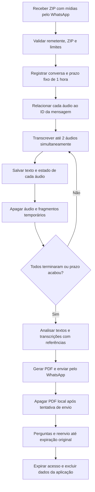

# Planejamento — transcrição de áudios na exportação

Data: 16/11/2026. Status: proposta para implementação; nenhuma mudança em produção.

## Objetivo e escopo

Prova de conceito para uso exclusivo do proprietário, com allowlist. Não é beta
público. A entrega só fica pronta quando os áudios presentes no ZIP aparecem
transcritos na posição correta do PDF e participam da análise e das perguntas.
Sem pesquisa de capacidade/planos do Supabase, sistema de usuários, billing,
fila externa ou serviço adicional de workers.

Esta proposta substitui, para a próxima implementação, a retenção de 24 horas
do plano de 14/11 por 1 hora desde o recebimento. A alteração ainda não foi aplicada.
Imagens continuam compatíveis com o fluxo existente e compartilham a expiração;
novas melhorias de imagens não são requisito desta entrega.

## Fluxo proposto



1. Receber exportação feita **com mídias**. Se os áudios não vierem, informar
   que não é possível recuperá-los a partir do texto exportado.
2. Validar limites, caminhos e conteúdo antes de transcrever. Uma importação em
   processamento por vez, no processo atual. Outra solicitação recebe aviso de
   ocupado; não fica em fila com arquivos retidos.
3. Criar revisão da conversa e prazo absoluto. Preservar autor, data, hora e
   `msg-id`; relacionar o nome do anexo à mensagem sem adivinhar associações.
4. Manter ZIP apenas até preparar os anexos necessários. Liberar seu buffer
   antes das chamadas de transcrição; manter somente áudios ainda necessários.
5. Usar o transcritor existente, sem etapa de reescrita/refinamento. Dividir áudio
   longo em fragmentos ordenados. Não deduzir identidade de quem fala: o autor
   da mensagem é quem enviou o áudio, não necessariamente a voz gravada.
6. Salvar resultado incrementalmente, preservando o prazo original. Excluir
   arquivos de cada áudio após sucesso ou falha definitiva e liberar seus buffers.
7. Analisar o conteúdo enriquecido e gerar PDF cronológico. Cada áudio aparece
   como “Transcrição automática”, com duração, autor, horário e referência.
   Informar totais: encontrados, transcritos, ausentes e com falha. Não apresentar
   uma exportação incompleta como integralmente transcrita.
8. Enviar PDF. Perguntas e `reenviar pdf` usam os textos salvos; não transcrevem
   novamente nem renovam a expiração. `esquecer conversa` antecipa a exclusão.

## Dados: reaproveitar a estrutura existente

Não criar banco temporário de arquivos nem bucket de áudio. Na POC, usar uma
linha em `pending_states` por remetente, com `kind = wa_export`, como já ocorre.
O banco guarda estado e texto; os binários existem apenas no processamento.

| Local | Conteúdo proposto |
|---|---|
| `pending_states.phone`, `kind` | Chave existente para localizar a conversa |
| `created_at`, `expires_at` | Recebimento e expiração absoluta, em UTC |
| `payload.version`, `revision` | Versão do formato e identificador da execução |
| `payload.status` | `processing`, `ready`, `partial`, `failed` |
| `payload.processing_deadline` | Limite de processamento de mídia: recebimento + 15 min |
| `payload.messages[]` | ID, autor, data/hora, texto e metadados dos anexos |
| `messages[].media[]` | Tipo, hash, duração, estado, transcrição, tentativas e código de erro sem conteúdo |
| `payload.analysis` | Conclusões e referências aos IDs originais |
| `blob_b64` | Sempre nulo para exportações; nenhum binário no banco |
| Diretório temporário por execução | Áudio em trabalho e fragmentos de conversão |

Estados de áudio: `pending → transcribing → ready / failed`; `missing` quando
o arquivo não acompanha o ZIP. Em reinício, itens incompletos viram
`needs_reupload`, pois os arquivos não são persistidos para retomada.
Campos novos exigem versionamento e leitura compatível com registros existentes.

Atualizações devem conferir revisão e expiração e nunca recriar uma conversa
apagada. Cache restrito ao mesmo proprietário e à conversa ainda válida;
nenhum cache global de transcrições. Reenvio idêntico não estende o prazo.
Uma nova exportação diferente substitui a anterior, descartando seus dados.
Não reutilizar resultados da conversa anterior de modo a estender sua retenção.

Acesso ao registro somente pelo backend autorizado, com RLS e permissões
compatíveis, sem acesso público. Conferir a configuração existente na implementação;
não alterar a segurança de outras funcionalidades como parte deste planejamento.

## Retenção proposta

| Dado | Onde fica | Quando sai |
|---|---|---|
| ZIP original | Memória durante ingestão | Logo após preparar anexos; também em erro/cancelamento |
| Áudios aguardando processamento | Memória do processo | Após processamento individual ou cancelamento do lote |
| Áudio em transcrição e fragmentos | Diretório temporário exclusivo | Ao terminar/falhar cada áudio; fragmentos após uso |
| Textos, transcrições, análise e metadados | Supabase/Postgres | 1 hora após recebimento, sem renovação por acesso |
| Imagens reduzidas, se presentes | Storage privado existente | Mesmo prazo absoluto da conversa |
| PDF gerado | Memória/temporário local | Após tentativa de envio; reenvio regenera a partir do texto |
| Logs operacionais | Logs do serviço | Sem áudios, transcrições, nomes de arquivos, telefones ou texto da conversa; só estado, duração, contagem e erro sanitizado |

O limite operacional do processamento de mídias é 15 minutos; cancelamento
encerra subprocessos e tentativas antes da limpeza. Não aguardar o lote inteiro
para liberar os bytes de um áudio já concluído. Gerar/analisar o relatório só
enquanto o registro estiver válido, com timeout também para análise e PDF.

Executar limpeza a cada minuto e no startup. Bloquear leitura, escrita e envio
imediatamente após expiração, mesmo antes da remoção física. Com o serviço
saudável, a meta de remoção física é até 1 minuto após expirar. Se o serviço
estiver parado, a limpeza ocorrerá na retomada; não prometer prazo absoluto de
remoção física durante indisponibilidade. Diretórios órfãos devem ser removidos
na inicialização, antes de aceitar novas importações, sem tocar arquivos de
outros fluxos. Falhas de limpeza devem ser visíveis e repetidas até sucesso.

O prazo acima cobre as cópias controladas pela aplicação. PDF recebido no
WhatsApp, cópias na Meta, processamento pelo provedor de transcrição e backups
não são apagados pelo TTL da aplicação. Antes de testar com conversas reais,
verificar as configurações e retenções aplicáveis dos provedores; este plano
não afirma conformidade legal nem exclusão dessas cópias em uma hora.

## Falhas e recuperação

- Falha transitória: até 3 tentativas no total, respeitando o prazo do lote.
- Áudio ausente, inválido ou sem resultado: marcar a ocorrência no PDF, sem
  inventar conteúdo. A transcrição é automática e pode conter erros.
- Falha em um fragmento: não publicar a concatenação dos demais como áudio
  completo. Marcar falha/incompletude e exigir novo envio para tentar novamente.
- Falha ao salvar: não informar sucesso nem manter arquivos indefinidamente.
  Limpar temporários e avisar sobre a necessidade de novo envio.
- Reinício: conservar somente resultados já salvos dentro do prazo; pedir ZIP
  novamente para áudios pendentes. Não recuperar arquivos de armazenamento remoto.
- Esquecer durante processamento: invalidar a revisão, cancelar tarefas ativas,
  limpar temporários e impedir gravação ou envio tardio. Confirmar exclusão apenas
  após verificar as cópias controladas pela aplicação.
- Timeout do lote: salvar os estados pendentes como incompletos e oferecer
  relatório parcial claramente identificado, caso ainda seja possível gerá-lo.
- Falha de entrega: manter textos apenas pelo tempo restante da hora original.
- Exportação sem áudios: PDF pode ser gerado, deixando explícito que os arquivos
  ausentes não foram transcritos.

## Limites iniciais e entrega

Reaproveitar os limites de proteção existentes: ZIP até 50 MiB, até 200 áudios
somando 60 minutos, até dez operações de mídia simultâneas, até 250 MiB de mídias lidas,
contexto enriquecido até 200 mil caracteres e PDF até 20 MiB. São limites da POC,
não promessa de completar qualquer lote em 15 minutos. Excesso de contexto gera
orientação para exportar menos conteúdo, sem truncamento silencioso.

Ordem de implementação:

1. Ajustar retenção, estados, limpeza e cancelamento; preservar compatibilidade.
2. Concluir integração áudio → texto incremental → análise → PDF.
3. Testar áudios sintéticos em português, múltiplos autores, duplicatas, ausência,
   erro de conversão, timeout, reinício, expiração, exclusão concorrente e reenvio.
4. Verificar conteúdo e ordem no PDF e ausência de binários no banco/Storage;
   testar limpeza com relógio controlado e inspeção dos temporários.
5. Validar container com dados sintéticos e depois uma exportação pequena real
   do proprietário; conferir recebimento do PDF no aparelho e perguntas sobre áudios.
6. Ativar somente para uso pessoal após validação; manter flag de rollback.

Critério de pronto: todos os áudios válidos do caso de teste aparecem no PDF na
posição correta; falhas ficam explícitas; perguntas usam as transcrições; reenvio
não chama o transcritor; expiração/exclusão impedem acesso e gravação tardia;
limpeza de arquivos comprovada. A implementação atual ainda não atende todo esse
contrato: TTL de 24h, limpeza de 15 em 15 min e buffers liberados ao final do lote
precisam ser ajustados. Testes gerais com falhas existentes exigem triagem separada
para distinguir regressões desta entrega.

## Implementação e validação local — 16/11/2026

Implementado no diretório de trabalho, ainda sem publicação no Railway:

- TTL de 1 hora para novas importações, contado desde o recebimento no handler;
  reenvio idêntico mantém o prazo e não reutiliza cache de outra exportação.
- Limpeza periódica a cada minuto; falha na limpeza de imagens não impede a
  limpeza do banco. Temporários de conversão órfãos são removidos no startup
  do serviço de processo único.
- ZIP liberado após preparação; bytes de cada mídia liberados após seu processamento;
  fragmentos de áudio removidos após uso. Cancelamento aguarda a limpeza do validador.
- `esquecer conversa` pode interromper importação mesmo com remetente ocupado;
  gravações e respostas verificam validade. Áudios interrompidos pedem reenvio.
- Resultado parcial explícito quando uma mídia falha. Falha de upload de imagem
  não interrompe os áudios. Um fragmento vazio não passa como áudio completo.
- Análise/comentários limitados a 120 segundos por etapa.

Validação: 42 testes focados em exportação passaram. Na execução da suíte geral
anterior aos dois últimos testes adicionados, 246 testes executados com as mesmas
2 falhas e 32 erros já presentes no início; não são certificação de suíte verde.
Também passaram 25 testes combinando handlers e os primeiros testes da POC.

Teste real de integração (somente dados sintéticos): ZIP com três gravações
portuguesas distintas e uma referência de áudio ausente. Whisper, análise e
Supabase reais; entrega Meta simulada. PASS em 25,14 s, PDF de quatro páginas,
365.807 bytes. Verificados reenvio sem nova análise, prazo inalterado, pergunta
com referências, isolamento, exclusão do registro e ausência de novos diretórios
 temporários. PDF inspecionado visualmente e textos das transcrições conferidos.

O teste completo com imagem encontrou HTTP 400 na integração de armazenamento.
O fluxo de áudio passou separadamente com `--audio-only`; configuração de imagens
continua pendente para validação integral de todos os tipos de mídia.

Comandos reproduzíveis:

```sh
.venv/bin/python -m unittest discover -s tests/aisha_unit/skills -t . -p 'test_export*.py'
.venv/bin/python -m scripts.check_export_media --live --audio-only --output /tmp/aisha-audio-poc-live
```

O segundo comando usa APIs reais e dados sintéticos; não envia WhatsApp. Os
artefatos sintéticos de QA são exportados deliberadamente para inspeção e não
seguem o ciclo de exclusão dos arquivos enviados por usuários. Próxima validação:
ZIP real enviado pelo proprietário, após definir teste local ou publicação no Railway.

Em 16/11, por solicitação do proprietário, o limite foi alterado de 2 para 10
operações de mídia simultâneas. Não representa uma taxa de 10 requisições/s.
